<p align="center">
  <a href="https://artfuldodger10.github.io/portfolio/">
    
  </a>
</p>

<p align="center">
  <a href="https://artfuldodger10.github.io/"></a>
  <a href="https://artfuldodger10.github.io/portfolio/"></a>
  <a href="https://www.linkedin.com/in/nader-ayman-569358286/"></a>
  <a href="mailto:naderelsehrawii@gmail.com"></a>
</p>

<p align="center"><i>"I don't just run the malware — I read its mind."</i></p>

---

## `> whoami`

Malware analyst and reverse engineer. I take a sample from the delivery chain down to the final
payload, recover how it hides its config, and turn that into **extractors, YARA rules and IOCs**
other analysts can reuse. Everything I reverse gets a write-up and a public repo.

## `> ls ./case_files`

| Case | Chain | What came out | |
|---|---|---|---|
| **Lumma Stealer** | Go loader / C++ crypter → hollowed `explorer.exe` / `MSBuild.exe` | one static config extractor for both chains, from disk or memory dump | [repo](https://github.com/ArtfulDodger10/lumma-stealer-campaign) · [Go](https://artfuldodger10.github.io/posts/Lumma-GO-Analysis/) · [C++](https://artfuldodger10.github.io/posts/Lumma-crypter-Analysis/) |
| **XWorm V7.1** | phishing RAR → JS dropper → PowerShell loader → `MSBuild.exe` | config extractor tested on V3.0–V7.4, YARA, ATT&CK layer | [repo](https://github.com/ArtfulDodger10/XWorm-Analysis) · [post](https://artfuldodger10.github.io/posts/Xworm-Analysis/) |
| **AgentTesla** | multi-stage loader → steganographic payload → hollowing | SMTP exfiltration config recovered | [post](https://artfuldodger10.github.io/posts/AgentTesla-RAT-Full-Malware-Analysis-Report/) |
| **Sysmon Mirage v2** | T1055 injection in C + x64 ASM: WinAPI → direct → indirect syscalls | what Sysmon telemetry survives each step | [repo](https://github.com/ArtfulDodger10/sysmon-mirage-v2) · [post](https://artfuldodger10.github.io/posts/Sysmon-mirage-v2/) |
| **YARA rules** | XWorm · AgentTesla · AsyncRAT | rules with the reasoning behind every string, FP-tested | [repo](https://github.com/ArtfulDodger10/yara-rules) |

## `> cat loadout.yml`

```yaml
analyst:  artfuldodger
focus:    [malware analysis, reverse engineering, detection engineering, threat intel]
reads:    [x86/x64 PE, .NET, Go, PowerShell, JavaScript, VBScript]
static:   [IDA Pro, Ghidra, dnSpy, Detect It Easy, capa, FLOSS]
dynamic:  [x64dbg, Sysmon, Wireshark, any.run, Triage]
ships:    [config extractors, YARA rules, IOCs, ATT&CK layers]
writes:   [C, C++, C#, Python, x64 assembly]
```

## `> tail -n 5 ./blog`

<!-- BLOG-POST-LIST:START -->
- [Lumma Campaign C++ Crypter](https://artfuldodger10.github.io/posts/Lumma-crypter-Analysis/)
- [Lumma Campaign GO Loader](https://artfuldodger10.github.io/posts/Lumma-GO-Analysis/)
- [XWorm — From Phishing Email to RAT](https://artfuldodger10.github.io/posts/Xworm-Analysis/)
- [XWorm Downloader — VBScript Analysis](https://artfuldodger10.github.io/posts/XWorm-RAT-Malware-Analysis/)
- [AgentTesla RAT](https://artfuldodger10.github.io/posts/AgentTesla-RAT-Full-Malware-Analysis-Report/)
<!-- BLOG-POST-LIST:END -->

---

<p align="center"><sub>no samples were harmed in the making of these reports. actually, all of them were.</sub></p>
